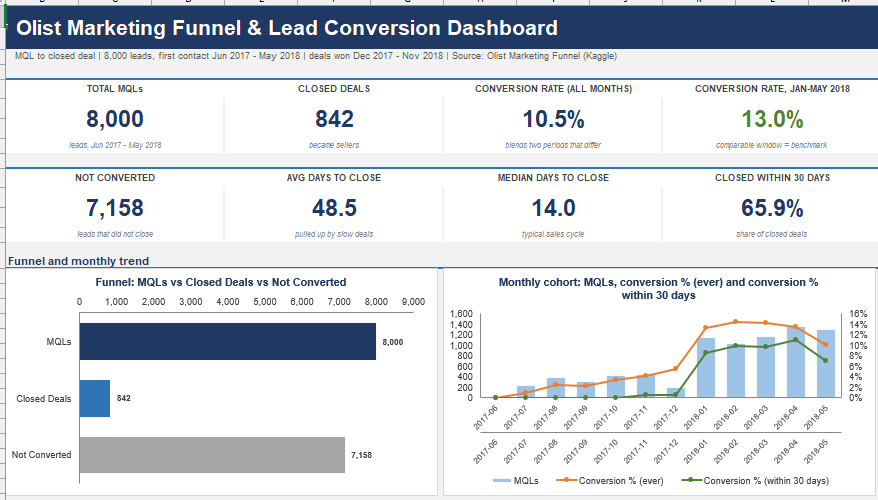
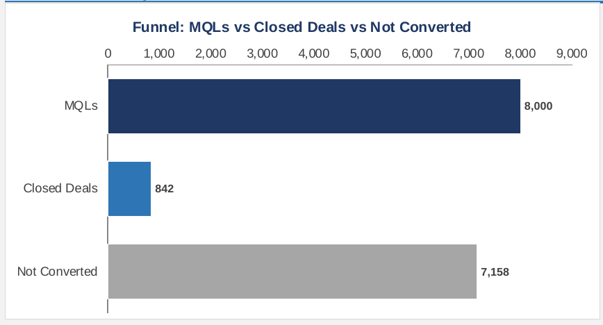
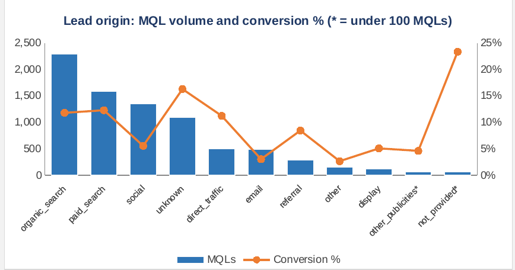
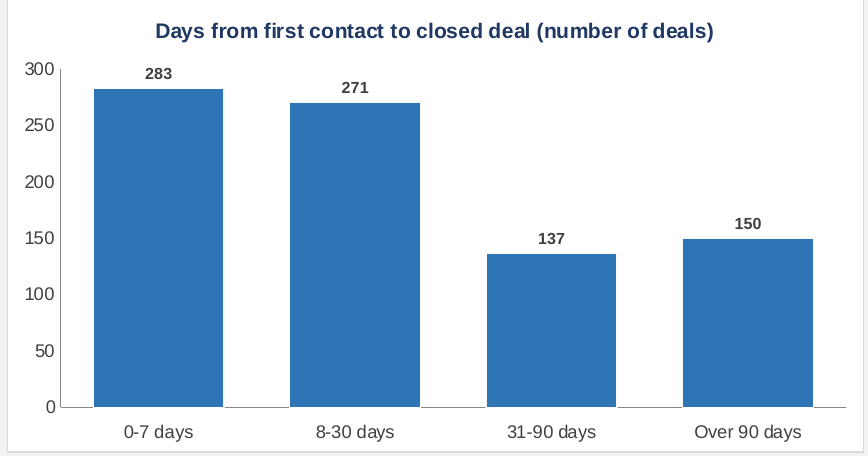

<h1 align="center">Olist Marketing Funnel & Lead Conversion Analysis</h1>

<p align="center">
  <b>Where do the customers who actually sign up come from, and how long does it take to win them?</b><br>
  An end-to-end analytics project on 8,000 sales leads using Python, SQL and Excel.
</p>

<p align="center">
  
  
  
  
</p>

<p align="center">
  
</p>

<div align="center">

| 8,000 | 842 | 10.5% | 13.0% | 14 days |
|:---:|:---:|:---:|:---:|:---:|
| **leads** | **signed up** | **sign-up rate** | **in the fair period (Jan-May 2018)** | **typical time to close** |

</div>

---

## Table of Contents

1. [About the Project](#about-the-project)
2. [Business Problem](#business-problem)
3. [Objectives](#objectives)
4. [Tools and Technologies](#tools-and-technologies)
5. [Dataset](#dataset)
6. [Methodology](#methodology)
7. [Key Findings](#key-findings)
8. [Dashboard](#dashboard)
9. [Business Recommendations](#business-recommendations)
10. [Project Structure](#project-structure)
11. [Conclusion and Future Scope](#conclusion-and-future-scope)

---

## About the Project

**Olist** is a Brazilian company that helps small businesses sell their products on online marketplaces. To grow, Olist runs a simple pipeline:

> **Marketing** attracts interested businesses (**leads**) &nbsp;->&nbsp; the **sales team** talks to them &nbsp;->&nbsp; some **sign up as sellers** (**closed deals**)

This project studies that pipeline. It follows **8,000 leads** from their first contact (June 2017 to May 2018) and shows **who signed up, where they came from and how long it took**, then turns the findings into actions a manager can use.

**The whole project in 30 seconds**

> Only about **1 in 10** interested businesses signs up. **Search** (unpaid and paid) brings half of all leads and over half of all sign-ups, while **social media and email** bring many leads but few sign-ups. Most deals close within a month, but about 1 in 6 take over three months. One in seven leads has **no known source**, so part of the picture is hidden. The advice: protect what works (search), investigate what does not (social and email), and fix the tracking.

**Words you will see**

| Word | Plain meaning |
|---|---|
| **Lead (MQL)** | A business that showed interest and was handed to the sales team |
| **Closed deal** | A lead that signed up and became a seller |
| **Conversion rate** | Out of every 100 leads, how many sign up (842 of 8,000 = 10.5 per 100) |
| **Origin (channel)** | Where the lead came from: unpaid search, paid ads, social media, email and so on |
| **Days to close** | Days from the first contact to the signed deal |

> This is a learning project built on a public dataset. It is not work done for Olist.

---

## Business Problem

Olist gets thousands of interested businesses, but **only about 10% become sellers**. Marketing money and sales time are limited, so the company needs to know where to put them.

The business wants answers to three plain questions:

| Question | Why it matters |
|---|---|
| **Which channels bring leads that actually sign up?** | Decide where marketing budget should go |
| **How long does a sale take?** | Decide when the sales team should follow up |
| **What do the winning deals look like?** | Understand who the new sellers are |

Without this view, the company would judge channels only by the *number* of leads, and would not notice that some high-volume channels convert poorly.

---

## Objectives

| # | Objective | Result |
|---|---|---|
| 1 | Measure how many leads become sellers, overall and by period | 10.5% overall, 13.0% in the fair Jan-May 2018 period |
| 2 | Find which lead sources convert well or badly | Search about 12%, social 5.6%, email 3.0% |
| 3 | Measure how long deals take to close | Median 14 days, average 48.5 days |
| 4 | Describe the closed deals (seller type, category, sales team) | Online-medium sellers are 39% of deals |
| 5 | Build a dashboard that anyone can read | Excel dashboard with 8 KPI cards and 6 charts |
| 6 | Give clear, testable recommendations | 7 recommendations with owners and success measures |

---

## Tools and Technologies

| Area | Tools | Used for |
|---|---|---|
| **Python** (Google Colab) | Pandas, NumPy | Cleaning, data checks, joining the two files, KPIs |
| **SQL** (MySQL 8) | Joins, `CASE`, CTEs, `ROW_NUMBER`, subqueries | 12 business queries on one analysis view |
| **Excel** | Native PivotTables, live formulas, charts, conditional formatting | The dashboard and a self-checking "Checks" sheet |
| **Documentation** | Word and PDF report, Git and GitHub | Reporting and sharing |

---

## Dataset

**Source:** [Marketing Funnel by Olist](https://www.kaggle.com/datasets/olistbr/marketing-funnel-olist) on Kaggle (see the page for licence terms). Two linked tables:

| Table | Rows | Columns | What it holds |
|---|---|---|---|
| **Marketing qualified leads** | 8,000 | 4 | Lead ID, first-contact date, landing page, origin (channel) |
| **Closed deals** | 842 | 14 | Which leads signed up: won date, seller type, product category, sales reps |

Every closed deal links to exactly one lead, so the two tables join cleanly. Column meanings are in [`data/data_dictionary.csv`](data/data_dictionary.csv).

**Data quality, in brief**

| What I found | What I did |
|---|---|
| 0 duplicates; every deal matches a lead | Nothing to fix |
| 60 leads with a blank origin | Labelled `not_provided` and kept separate from the recorded value `unknown` |
| 21% of deals have no behaviour profile | Labelled "Not Provided", never guessed |
| About 92% of questionnaire fields are blank | Not used (blank means not answered) |
| Declared revenue is 0 for 95% of deals | Not used |
| 1 deal won before the lead's first contact | Date gap left blank; the lead stays in the counts |

No rows were deleted.

---

## Methodology

```
   2 raw CSV files
         |
         v
   PYTHON (Colab) ....... check quality, clean, join leads to outcomes, calculate KPIs
         |
         v
   SQL (MySQL) .......... 12 business queries on one "one row per lead" view
         |
         v
   EXCEL ................ dashboard + 6 PivotTables + 18 automatic self-checks
         |
         v
   Insights and recommendations
```

1. **Checked and cleaned the data** with Python. Every decision is documented and no rows were deleted.
2. **Joined the two files** so each lead has an outcome: signed up or not. The join was validated as one-to-one.
3. **Answered the business questions twice**, once in Python and once in SQL, and compared the results.
4. **Built the Excel dashboard** with live formulas and native PivotTables, plus a Checks sheet.
5. **Wrote the insights** and turned them into recommendations with an owner and a way to measure success.

**How I know the numbers are right:** the Python, SQL and Excel results agree, and the workbook's Checks sheet runs 18 tests (row counts, totals adding up, pivot totals, KPIs matching) and reports **ALL CHECKS PASS**.

---

## Key Findings

| # | Finding | Evidence |
|---|---|---|
| 1 | **About 1 in 10 leads signs up** | 842 of 8,000 (10.5%) |
| 2 | **Search is the engine** | Unpaid plus paid search bring 48.5% of leads and 55.3% of sign-ups, with about 12 in 100 signing up |
| 3 | **Social media and email bring crowds, not customers** | 23% of leads but only 10.7% of sign-ups (social 5.6 per 100, email 3.0 per 100) |
| 4 | **Most deals are quick, a few are very slow** | Median 14 days; 66% close within a month; about 18% take over 3 months |
| 5 | **Many leads have no known source** | 14.5% (1,159) have an unknown or blank origin |
| 6 | **Winners are mostly one type** | "Online medium" sellers are 39% of signed deals; the top 5 product categories are 49% |

> **Important:** the first deal in the data was won in December 2017, so leads from June to December 2017 show only **3%** sign-up against **13%** from January 2018. That jump is mostly a data-coverage effect, not proof of improvement. The fair benchmark is **13 in 100** (January to May 2018).

### The 3 charts that matter

<p align="center">
  
</p>

**1. The funnel.** Out of 8,000 interested businesses, only 842 signed up (about 1 in 10). The other 7,158 did not.

<p align="center">
  
</p>

**2. Which channels work.** The blue bars show how many leads each channel brought, and the orange line shows how many of them signed up. Search brings the most leads and converts well, while social and email bring many leads but few sign-ups.

<p align="center">
  
</p>

**3. How long a deal takes.** Two thirds of deals close within a month, but 150 of 841 take more than 90 days. Slow deals need their own follow-up.

---

## Dashboard

The dashboard is an Excel workbook ([`excel/Olist_Funnel_Dashboard.xlsx`](excel/Olist_Funnel_Dashboard.xlsx)). 


| Part of the dashboard | What it answers |
|---|---|
| **8 KPI cards** | How many leads, how many signed up, the sign-up rate (all months and the fair period), and how fast |
| **Funnel and monthly chart** | How many leads convert, and how that changes by month (with a warning about early months) |
| **Lead origin chart and table** | Which channels bring leads that sign up, with arrows showing better or worse than average |
| **Lead type, days to close and segments** | Who the winning sellers are and how long they take |
| **Landing pages table** | Which pages bring leads, and a reminder that page and channel effects are tangled |
| **PivotTables sheet** | 6 native Excel PivotTables for exploring the data |
| **Insights sheet** | 11 findings whose evidence cells are live formulas |
| **Checks sheet** | 18 tests that prove the numbers add up |

---

## Business Recommendations

These are suggestions based on patterns in the data. Test them before changing budgets.

| # | Action | Why | How to measure success |
|---|---|---|---|
| 1 | **Review lead quality and follow-up for social and email** before adding budget | Many leads, few sign-ups | Monthly sign-up rate by channel |
| 2 | **Keep investing in search** | Half of the leads and over half of the sign-ups | Share of signed deals from search |
| 3 | **Fix tracking of where leads come from** | 14.5% of leads have no usable source | Share of leads with unknown or blank origin |
| 4 | **Follow up around the 30-day mark** and treat 90+ day deals separately | A third of deals take longer than a month | Share of deals closed within 30 days |
| 5 | **Use Jan-May 2018 as the benchmark** and compare months on a fixed 30-day window | Early months are not comparable | Sign-up rate on a like-for-like window |
| 6 | **Record seller type and category at the start** | So sign-up rates by type can be measured | Rate by seller type becomes available |
| 7 | **Record how many leads each rep handles** | Closed deals alone cannot judge a rep fairly | Sign-up rate per rep |

**Size of the opportunity (illustrative, not a forecast):** from January to May 2018, if social and email had signed up 8%, 10% or 12% of their leads instead of about 6%, that would mean roughly **32, 60 or 88 extra deals** on top of the 781 actually won.

---

## Project Structure

```
Olist-Marketing-Funnel-Lead-Conversion/
|
|-- README.md
|-- .gitignore
|
|-- data/
|   |-- data_dictionary.csv                # what every column means
|   |-- raw/                               # the 2 original Kaggle CSV files
|   |-- cleaned/                           # cleaned tables + one-row-per-lead analysis table
|   `-- query_results/                     # results of the 12 SQL queries
|
|-- python/
|   `-- Olist_Funnel_Analysis_Colab.ipynb  # cleaning, checks, KPIs, insights
|
|-- sql/
|   |-- 01_create_database_and_tables.sql
|   |-- 02_load_data.sql
|   |-- 03_data_quality_and_cleaning.sql
|   `-- 04_analysis_queries.sql
|
|-- excel/
|   |-- Olist_Funnel_Dashboard.xlsx        # dashboard, 6 PivotTables, insights, checks
|   `-- dashboard_screenshot.png
|
`-- documents/
    |-- Olist_Funnel_Project_Report.pdf    # full project report
    |-- Olist_Funnel_Project_Report.docx
    `-- images/                            # charts used in this README and the report
```

**How to explore it:** read this page, then open the [PDF report](documents/Olist_Funnel_Project_Report.pdf); open the Excel dashboard (the *Checks* sheet shows ALL CHECKS PASS); or open the notebook in Google Colab and run the SQL scripts in MySQL Workbench in order, `01` to `04`.

---

## Conclusion and Future Scope

**Conclusion.** About 1 in 10 Olist leads becomes a seller. Search is the reliable engine at about 12 sign-ups per 100 leads, while social media and email bring volume but convert poorly. Half of all deals close within two weeks, but a long tail of slow deals pulls the average up to 48.5 days. The most useful lesson is that **volume is not value**: judging channels only by how many leads they bring would hide the ones that actually produce sellers.

**Things to keep in mind**

- Months before 2018 are **not comparable** with later months (deal recording starts in December 2017).
- Seller type, category and sales-rep views describe **only signed deals**, so they show shares and counts, not sign-up rates, and they do not rank reps.
- The data shows **patterns, not causes**, and has no cost or revenue data, so no return on investment is calculated.
- Only two funnel stages exist (lead and signed deal), so the exact step where leads drop out cannot be seen.

**Future scope**

- Add **marketing cost** to measure the cost of winning one seller by channel.
- Analyse **landing pages together with channel**, since the biggest weak pages are about 94% social traffic.
- Capture the **missing funnel stages** (contacted, consultancy) to see where leads drop out.
- Build a **simple scoring rule** or model to rank new leads, once more history is available.

---


