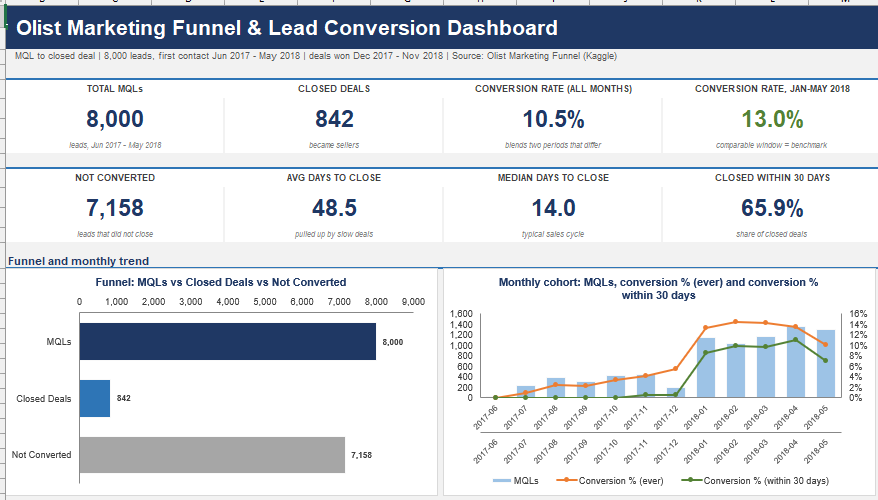
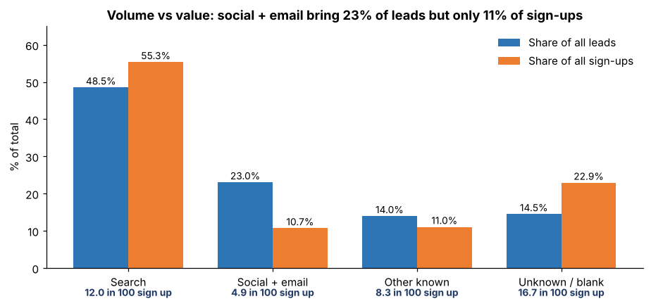
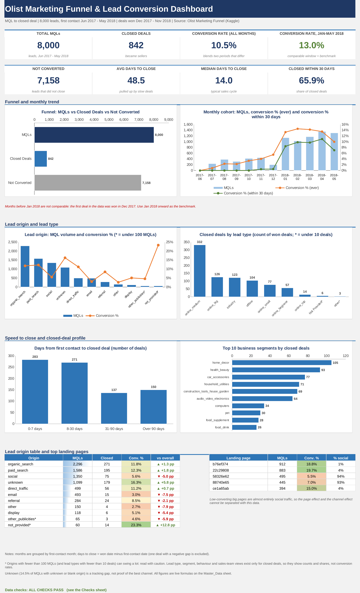
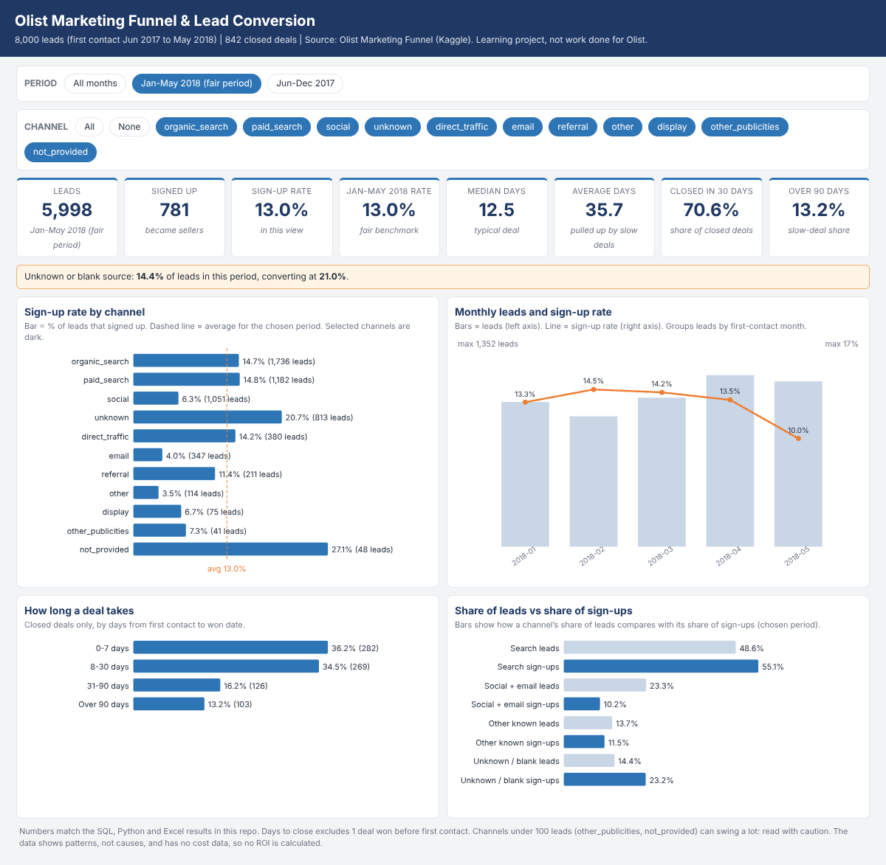

# Olist Marketing Funnel & Lead Conversion Analysis



**Which marketing channels turn leads into sellers, how long does a sale take, and which numbers can we trust?**
An end-to-end analytics project on Olist's marketing funnel (8,000 leads, 842 closed deals) using **SQL, Python, Excel and an interactive dashboard**, with Business Analyst documentation.

> Learning project built on a public Kaggle dataset. It is not work done for Olist.

**Tools:** MySQL 8 | Python (pandas, NumPy, SciPy, Matplotlib) | Excel (PivotTables, formulas, charts) | HTML/JavaScript dashboard | Jupyter/Colab

## Contents
[Problem](#1-business-problem) | [Dataset](#2-dataset) | [Method](#3-methodology) | [Findings](#4-key-findings) | [Dashboard](#5-dashboards) | [SQL](#6-sql-analysis) | [Python and statistics](#7-python-and-statistics) | [Recommendations](#8-recommendations-and-business-impact) | [BA documents](#9-business-analyst-documents) | [Limits](#10-limitations) | [Run it](#11-how-to-run) | [Structure](#12-repository-structure)

---

## 1. Business Problem
**Company.** Olist is a Brazilian marketplace platform. It grows by signing up small online sellers from marketing leads (MQLs, marketing qualified leads: people who showed interest through a landing page).

**Problem.** Only about 1 in 10 leads becomes a seller, and marketing budget and sales time are limited.

**Objectives**
1. Measure funnel conversion (lead to closed deal) and set a fair benchmark.
2. Find which lead sources convert and which only bring volume.
3. Measure how long a sale takes, to plan follow-up.
4. Check which numbers can be trusted and which are distorted by the data.

**Stakeholders:** Marketing Manager (budget), Sales Manager (follow-up), BI / Sales Operations (tracking), Leadership (funnel health).

**KPIs:** conversion rate, closed deals, median and average days to close, closed within 30 days, share over 90 days, share of unknown-source leads.

## 2. Dataset
Source: [Olist Marketing Funnel, Kaggle](https://www.kaggle.com/datasets/olistbr/marketing-funnel-olist). Raw files are in `data/raw/`.

| Table | Rows | Content |
|---|---|---|
| `olist_marketing_qualified_leads_dataset.csv` | 8,000 | One row per lead: `mql_id`, `first_contact_date`, `landing_page_id`, `origin` |
| `olist_closed_deals_dataset.csv` | 842 | One row per won lead: `won_date`, seller type, business segment, behaviour profile |

Every closed deal matches exactly one lead (`mql_id`). First contact runs from Jun 2017 to May 2018; deals are won from Dec 2017 to Nov 2018. Full column meanings: [`data/data_dictionary.csv`](data/data_dictionary.csv).

**Data quality (nothing deleted):** 60 blank origins (kept as `not_provided`), 21% of deals missing behaviour profile, about 92% of questionnaire fields blank, declared revenue 0 for 95% of deals, 1 deal won before first contact (excluded from days-to-close only).

**The most important data fact:** the first deal in the data is won in **December 2017**. Leads from Jun-Dec 2017 convert at only 3% against 13% from Jan 2018, because deal recording is incomplete in 2017, not because the business was worse. **Jan-May 2018 is the fair benchmark period.**

## 3. Methodology
1. **Check and clean** the two tables in Python and SQL: duplicates, blanks, date order, join integrity.
2. **Join** with a LEFT JOIN so every lead is kept: converted = has a deal. This gives one row per lead (`lead_master`).
3. **Business questions** answered in SQL (21 queries) and cross-checked in pandas and Excel.
4. **Fair-period check:** repeat the key results on Jan-May 2018 only.
5. **Statistics:** chi-square, Cramer's V, Wilson confidence intervals, Mann-Whitney, Kruskal-Wallis.
6. **Dashboards** (Excel and interactive) and **recommendations**.

## 4. Key Findings

| # | Finding | Evidence |
|---|---|---|
| 1 | About 1 in 10 leads signs up | 842 of 8,000 = **10.5%**; **13.0%** in Jan-May 2018 |
| 2 | **Search is the engine** | 48.5% of leads, 55.3% of sign-ups; organic 11.8%, paid 12.3% (14.7% and 14.8% in the fair period) |
| 3 | **Social and email bring volume, not sellers** | 23% of leads, 10.7% of sign-ups; social 5.6%, email 3.0% (6.3% and 4.0% in the fair period) |
| 4 | **Leads with unknown source convert best** | 14.5% of leads, 22.9% of sign-ups, 16.7% conversion (20.7% in the fair period). Fixing tracking is valuable; unknown is not a channel to buy |
| 5 | **Typical deal is fast, the tail is partly an artefact** | All months: median 14, average 48.5, 17.8% over 90 days. Fair period: **median 12.5, average 35.7, 70.6% within 30 days, 13.2% over 90** |
| 6 | Wolf-profile deals are slower | Median 36 days vs 13 (cat) and 10 (eagle); p < 0.001 |
| 7 | May 2018 conversion dipped | 10.0% vs 13.4% expected from its channel mix; still lower at day 60 and 90 |
| 8 | Demand is concentrated | Top 5 business segments = 49% of closed deals (home decor leads with 105) |
| 9 | Channel ranking is stable | Same order in the fair period (social and display swap, display is small) |



**Two traps in this data (strong interview points)**
- *Recording-start trap:* early months look weak because deals were only logged from Dec 2017.
- *Same trap, other metric:* Jun-Nov 2017 leads appear only if they closed late (median 216 days), which inflates the average sales cycle. I report both the all-months and fair-period views.

## 5. Dashboards
**Excel dashboard** (`excel/Olist_Funnel_Dashboard.xlsx`): 8 KPI cards, 6 charts, 6 PivotTables, an Insights sheet (11 findings) and a Checks sheet (18 tests, all pass). All figures are live formulas.



**Interactive dashboard** (`dashboard/olist_funnel_dashboard.html`): download and double-click, no software needed. Filter by **period** and **channel**; 8 KPIs and 4 charts update together. Try *Jan-May 2018 + social only* (6.3%) against *unknown only* (20.7%).



To host it free, enable GitHub Pages (Settings > Pages > main branch) and the page opens at `https://saniya1312s.github.io/Olist-Marketing-Funnel-Lead-Conversion/dashboard/olist_funnel_dashboard.html`.

**Power BI:** not built yet; a step-by-step guide with DAX is in [`powerbi/POWERBI_BUILD_GUIDE.md`](powerbi/POWERBI_BUILD_GUIDE.md).

## 6. SQL Analysis
Run in order `01` to `05` (MySQL 8). Tested end to end on a real database; every result is saved in `data/query_results/`.

| File | Purpose |
|---|---|
| `01_create_database_and_tables.sql` | Database and tables |
| `02_load_data.sql` | Load the CSVs |
| `03_data_quality_and_cleaning.sql` | Quality checks and the `lead_master` view |
| `04_analysis_queries.sql` | 12 queries: funnel KPIs, comparable window, monthly cohort, conversion by origin, landing pages, median days, bands, lead type, segments, SDR workload |
| `05_sql_showcase_advanced.sql` | 9 advanced queries (below) |

| Query | Business question | Technique |
|---|---|---|
| A1 | Which channels bring volume without value? | CTE, `SUM() OVER ()` |
| A2 | Is the channel ranking stable in the fair period? | `RANK()`, `HAVING`, conditional aggregation |
| A3 | Which channels to scale, review or fix tracking? | `CASE` segmentation |
| A4 | Is the slow tail real? Median, P25, P75, P90 by period | `ROW_NUMBER()`, percentiles |
| A5 | How fast does each month's cohort close? | Cohort analysis |
| A6 | Is conversion improving? | `LAG()`, moving average |
| A7 | When were deals recorded? | Recursive CTE, running total |
| A8 | Which categories make up most new sellers? | Pareto, running share |
| A9 | Which behaviour profiles are slow? | Window median by group |

## 7. Python and Statistics
| File | Content |
|---|---|
| `python/Olist_Funnel_Analysis_Colab.ipynb` | Notebook 1: quality checks, cleaning, joins, KPI tables, Excel export |
| `python/02_eda_and_visuals.ipynb` | Notebook 2: outlier check (IQR), 4 charts, fair-period analysis, tests, findings table |
| `python/03_statistical_tests.py` | Reproducible tests, writes `data/query_results/stat_summary.txt` |

| Test | Result | Meaning |
|---|---|---|
| Chi-square, origin vs sign-up | chi2 = 140.7, p < 0.001 (138.8 in Jan-May) | Channel and sign-up are linked |
| Cramer's V | 0.13 (0.15 in Jan-May) | Modest effect: channel matters, but is not the only driver |
| 95% interval, search vs social + email | 14.7% (13.5 to 16.1) vs 5.7% (4.6 to 7.1) in Jan-May | Ranges do not overlap, so not luck |
| Mann-Whitney, wolf vs cat days | p < 0.001 | Wolf deals really are slower |

## 8. Recommendations and Business Impact

| # | Recommendation | Owner |
|---|---|---|
| 1 | Review lead quality and follow-up for social and email before adding budget | Marketing Manager with Sales Manager |
| 2 | Keep investing in search, and check paid-search cost first | Marketing Manager |
| 3 | Fix lead-source tracking (unknown leads convert at 16.7%) | Sales / BI Operations |
| 4 | Follow up around day 30; handle 90+ day deals and wolf-profile leads separately | Sales Manager |
| 5 | Ask the data owner why May 2018 dipped; monitor June onward | BI team |
| 6 | Record seller type and category at the start of the lead | Sales Operations |
| 7 | Record leads handled per sales rep | Sales Manager |

**Illustrative impact (not a forecast).** If social and email moved from about 6% to 8%, 10% or 12% in Jan-May 2018, that is roughly **32, 60 or 88 extra deals** on top of 781 (4%, 8% or 11% more). No cost data exists, so no ROI or CAC is calculated.

## 9. Business Analyst Documents
| Document | Content |
|---|---|
| [`docs/01`](docs/01_business_context_and_domain.md) | Business context, domain terms, KPIs, business questions |
| [`docs/02`](docs/02_BRD_lite_and_user_stories.md) | BRD-lite, requirements, user stories, acceptance criteria |
| [`docs/03`](docs/03_process_as_is_to_be.md) | As-Is and To-Be process flows |
| [`docs/04`](docs/04_risk_register_and_stakeholder_matrix.md) | Risk register, stakeholder matrix, recommendation owners |
| [`docs/05`](docs/05_dashboard_wireframe.md) | Dashboard wireframes and reading guide |
| [`docs/06`](docs/06_interview_prep_and_resume.md) | Interview answers and resume bullets |
| [`docs/07`](docs/07_case_study_one_pager.md) | One-page case study |
| [`documents/`](documents/) | Written project report (PDF and Word). It covers findings 1-8 as of the first version; the fair-period days-to-close view and the May check are in this README and Notebook 2 |

## 10. Limitations
- No cost or revenue data, so no ROI or CAC.
- Only two funnel stages (lead and won deal).
- Days to close covers closed deals only; leads still open at the end are invisible, so true cycles are likely longer.
- Observational data shows patterns, not causes. Landing page and channel are tangled together.
- Lead type, segment and behaviour exist only for closed deals, so they show counts, not conversion rates.
- Channels under 100 leads can swing a lot.

## 11. How to Run
```bash
git clone https://github.com/Saniya1312S/Olist-Marketing-Funnel-Lead-Conversion.git
cd Olist-Marketing-Funnel-Lead-Conversion
pip install -r requirements.txt
python python/03_statistical_tests.py      # statistics (from the repo root)
```
- **SQL:** run `sql/01` to `sql/05` in MySQL Workbench (enable `LOCAL INFILE`; set your own CSV path in `02`). Run one query at a time.
- **Notebooks:** open in Jupyter, or use Colab (Notebook 2 reads the raw files from GitHub automatically).
- **Dashboards:** open the `.xlsx` in Excel, or the `.html` in any browser.

## 12. Repository Structure
```
├── README.md
├── requirements.txt
├── data/
│   ├── raw/             original Kaggle CSVs
│   ├── cleaned/         cleaned tables and lead_master.csv
│   ├── query_results/   saved SQL and statistics outputs
│   └── data_dictionary.csv
├── sql/                 01 to 05
├── python/              2 notebooks + statistical tests script
├── excel/               dashboard workbook and screenshot
├── dashboard/           interactive HTML dashboard
├── powerbi/             Power BI build guide
├── docs/                BA documents 01 to 07 + data dictionary
└── documents/           project report and chart images
```

## Skills Demonstrated
SQL (CTEs, window functions, recursive CTE, percentiles, cohorts) | Python (pandas, SciPy, Matplotlib) | Statistics (chi-square, confidence intervals, non-parametric tests) | Excel (PivotTables, live formulas, self-checks) | Dashboard design | Business analysis (BRD, user stories, risks, process flows) | Questioning data for bias
