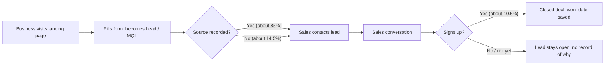
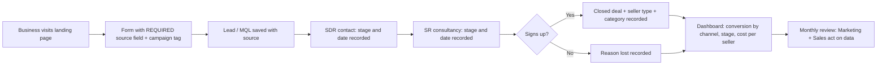

# 03. Process Flow: As-Is vs To-Be

## As-Is (what the data shows today)

**Pain points in the As-Is process**
1. About 1 in 7 leads has no known source, so channel credit is hidden.
2. Only two stages are recorded (lead and closed deal), so drop-out points are invisible.
3. No cost data is linked to channels, so cost per customer cannot be measured.
4. Leads that do not sign up have no recorded reason.

## To-Be (proposed improvement)

**What changes**

| As-Is | To-Be | Recommendation it supports |
|---|---|---|
| Source can be blank or "unknown" | Source field required, campaign tag added | Rec. 3 |
| Two stages only | SDR and SR stages recorded with dates | Future scope |
| Seller type known only after the deal | Recorded at the start | Rec. 6 |
| Leads per rep not recorded | Leads handled per rep recorded | Rec. 7 |
| No reason for lost leads | "Reason lost" captured | Future scope |
| Channel cost not linked | Cost per channel added | Future scope (CAC) |
